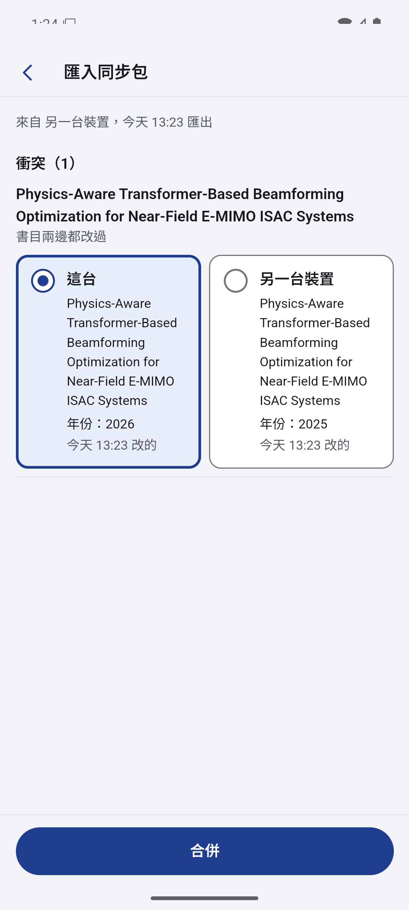

# 備份與同步包

PaperReader 有兩種把文獻庫帶走的檔：**備份檔**與**同步包**。兩種都是你自己匯出、自己搬的檔案，應用不會自動傳到任何地方。

## 兩者的不同

| | 備份檔 | 同步包 |
|---|---|---|
| 用途 | 防遺失、換手機 | 兩台裝置都在用，讓兩邊的修改合在一起 |
| 帶什麼 | 整個文獻庫 | 文獻庫的變更（預設只帶變更；可以選完整的） |
| 放回去的方式 | 「從備份檔還原」：做出一個文獻庫。不和現有的合併 | 「匯入同步包」：合併進現有的文獻庫，兩邊的修改都留下 |
| 在哪裡 | 「設定 → 文獻庫」的「匯出備份檔」「從備份檔還原」 | 「設定 → 文獻庫 → 同步」 |

兩種檔都是 zip，用一般的解壓縮工具打得開；備份檔解開後的 `library` 資料夾就是一個完整的文獻庫。

兩種檔都**不帶**：翻譯服務的金鑰、應用的設定、術語庫（這些存在手機上，不在文獻庫裡），以及別的工具放在文獻庫裡的隱藏資料夾（例如 Obsidian 的 `.obsidian`）。換手機之後，金鑰要重新填，術語庫請先在舊手機「匯出 TSV」。

## 備份檔

### 匯出

1. 「設定 → 文獻庫 → 匯出備份檔」。
2. 做好之後出現「備份檔做好了」，寫明有幾個檔案、多大。
3. 按「存到…」選位置存下來，或按「分享」交給雲端硬碟、通訊軟體等。按「先不存」就不存。

少數檔案放不進備份檔時（例如檔名不是正常的文字、是捷徑），畫面會列出是哪些檔、為什麼，其餘照常放進去。每一份做好的備份檔都還原得了。

### 還原

1. 「設定 → 文獻庫 → 從備份檔還原」。
2. 看過說明之後按「選擇備份檔」，選那個檔。還原時請不要離開應用。

| 現在的文獻庫 | 還原之後 |
|---|---|
| 是空的 | 用備份檔建立文獻庫 |
| 已經有文獻 | 用備份檔做出新的文獻庫並換過去；原本的文獻庫原樣留著，畫面寫出兩個位置 |

選到同步包時，應用會說「這是同步包，請在設定的「同步」匯入。」，文獻庫不會有任何改變。

## 兩台裝置之間用同步包

### 第一次：讓第二台有同一個文獻庫

兩台要先有「同一個」文獻庫，之後才能互相合併。

1. **在原本那台（A）**：「設定 → 文獻庫 → 同步」，打開「完整的同步包」，按「匯出同步包」，存下來或分享出去。也可以用剛匯出的備份檔。
2. **把檔搬到新的那台（B）**：用雲端硬碟、通訊軟體、傳輸線都可以。
3. **在 B**：安裝 PaperReader，首頁還是空的時按「從另一台加入」。和第一次加入文獻一樣，先決定文獻庫放在哪裡，再按「選擇檔案」選那個檔。
4. 出現「已加入」，B 就有和 A 相同的文獻、筆記、劃線與閱讀紀錄。

請用 A 剛匯出的檔。用很久以前的檔加入，那段期間在 A 刪掉的東西可能在第一次同步後回來。

### 之後：來回同步

在 A 讀過、劃過線之後，要讓 B 也有：

1. **在 A**：「設定 → 文獻庫 → 同步 → 匯出同步包」。預設只帶變更，檔案小；B 從沒匯入過 A 的同步包時，這一份會自動是完整的。
2. 把檔搬到 B。
3. **在 B**：「設定 → 文獻庫 → 同步 → 匯入同步包」，選那個檔。
4. 出現預覽頁「匯入同步包」，先看會新增、更新、移除什麼，有衝突就選要留哪一邊（下一節）。
5. 按「合併」。完成後出現「合併好了」。

反方向（B 到 A）照同樣的步驟。在預覽頁按返回就放棄這次匯入，什麼都不會改。

合併之後打開一篇，如果另一台讀得比較後面，畫面會說「另一台讀到第 N 頁」，可以直接跳過去。

### 衝突怎麼選

兩邊都改過同一樣東西、應用判斷不了哪個該留時，預覽頁會在「衝突」底下列出來，每一項有兩到三張卡片可以選。

| 卡片 | 意思 |
|---|---|
| 這台 | 留這支手機上的 |
| 另一台裝置（或那台的名稱） | 用同步包裡的 |
| 兩個都留 | 留這台的，另一台的那份筆記另存成「衝突副本」 |

每張卡片寫著那一邊的內容與修改的時間。會問的有這幾種：書目兩邊都改過、劃線的短評兩邊都改過、一邊刪了這條劃線另一邊改過、整篇的想法兩邊都改過、同一份檔案兩邊不同、譯文兩邊都改過、一邊在回收區另一邊在目錄。其餘的情況有固定的規則，不問：例如一邊加了劃線、另一邊沒動，就直接加進來。

**衝突副本**是一份放在筆記檔旁邊的 Markdown 檔，檔名是原本的筆記檔名後面加上 `(conflict …)`。應用不讀它，你可以在筆記工具裡對照兩份，把要的內容搬回原本的筆記檔，再刪掉副本。

### 合併被打斷時

合併途中應用被關掉，下一次打開時會先把它做完。做完之前文獻庫暫時只能看，同步頁會寫「上一次的合併沒做完，文獻庫暫時只能看。」，按「重試」。

## 已知限制

| 限制 | 怎麼避免 |
|---|---|
| 在應用以外刪掉的劃線或文獻（在筆記工具裡刪一條劃線、在檔案管理員裡刪一篇的資料夾），同步之後會從另一台回來 | 要刪劃線與文獻，請在應用裡刪，另一台才會跟著刪 |
| 應用靠兩台各自的時鐘判斷哪邊的修改較新，時鐘差很多時可能判錯 | 兩台裝置的時間都設成自動 |
| 同一份 PDF 在兩台各加一次，合併後會變成兩篇 | 合併後把其中一篇移除。之後只在一台加入，再同步過去 |
| 兩台各把同一篇放進不同的群組，合併後只留較晚改的那一邊的群組 | 群組在一台改好，再同步過去 |
| 有三台以上時，只帶變更的同步包可能缺檔，那一篇這次不合併，畫面會請你「在另一台匯出完整的同步包」 | 照提示打開「完整的同步包」再匯出一次 |
| 你自己放進文獻資料夾、應用沒有列為材料的檔，不放進同步包 | 這些檔仍然在備份檔裡 |
| 另一台的應用版本較新時，那台用新格式寫的檔這次不合併 | 兩台都更新到最新版 |
| 只能手動搬檔，沒有自動同步 | — |

要把既有的一批論文（不是另一台 PaperReader 的文獻庫）收進來，用首頁「＋」的整批匯入：一個資料夾或 zip 加一份 `paperreader-import.json` 清單，格式見[匯入清單](../規格/04_匯入清單.md)。

---

截圖中的論文：*Physics-Aware Transformer-Based Beamforming Optimization for Near-Field E-MIMO ISAC Systems*（[arXiv:2611.16305](https://arxiv.org/abs/2611.16305)，作者見該頁），以 [CC BY 4.0](https://creativecommons.org/licenses/by/4.0/) 授權。截圖只縮放顯示；兩邊年份不同是為了示範衝突而改的。
