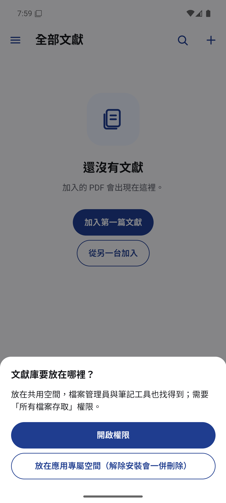
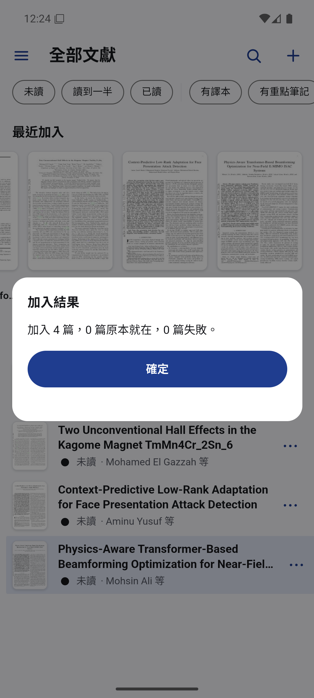

# 安裝與第一次使用

這份教學帶你從下載安裝檔開始，到在手機上打開第一篇文獻。大約需要十分鐘。做完之後，你會有一個放在自己手機上的文獻庫，裡面有一篇可以閱讀、劃線的 PDF。

> PaperReader 還在 0.x 預覽階段：功能與檔案格式都可能變動。

## 你需要準備

| 項目 | 說明 |
|---|---|
| 一支 Android 手機 | Android 7.0 以上可以安裝。文獻庫要放在共用空間（見第 3 步）需要 Android 11 以上 |
| 一份論文 PDF | 已經下載到手機上，或在別的應用裡打得開 |
| 網路 | 只有下載安裝檔時需要。之後加入、閱讀、劃線、筆記都不連網 |

不需要帳號，也不需要電腦。

## 1. 下載安裝檔

1. 在手機的瀏覽器打開 PaperReader 在 GitHub 的版本庫，進入「Releases」頁。
2. 在最新的版本底下，依手機的種類下載一個安裝檔：

| 安裝檔 | 給誰 |
|---|---|
| `PaperReader-版本-arm64.apk`（例如 `PaperReader-0.1.1-arm64.apk`；修正版的版本多一段，例如 `PaperReader-0.1.1.1-arm64.apk`） | 大部分的手機。不確定時下載這一個 |
| `PaperReader-版本-x86_64.apk` | 電腦上的 Android 模擬器，與少數用 Intel／AMD 處理器的裝置 |

裝錯了，系統會拒絕安裝，換另一個就好（拒絕時的訊息依手機而不同）。

PaperReader 目前只在 GitHub 提供安裝檔，不在應用商店上架。

### 核對安裝檔（可以跳過）

同一個版本底下有一個 `SHA256SUMS.txt`，寫著每個安裝檔的 SHA-256（一串 64 個字的核對碼）。你算出的和它一樣，就表示下載的檔完整、和發布的是同一份。

- 在 Windows 電腦上：在 PowerShell 執行 `Get-FileHash 下載的檔名.apk -Algorithm SHA256`，把結果和 `SHA256SUMS.txt` 裡那一行比對（大小寫不同沒關係）。
- 在 macOS 或 Linux 上：在終端機執行 `shasum -a 256 下載的檔名.apk`。
- 在手機上：用任何能算 SHA-256 的檔案管理員或應用（PaperReader 不指定哪一個）。

對不上就不要安裝，重新下載一次。

## 2. 允許安裝並安裝

從商店以外安裝應用，Android 會先請你允許「下載安裝檔的那個應用」安裝別的應用。

1. 在瀏覽器的下載清單或檔案管理員裡，點剛下載的安裝檔。
2. 系統說不允許安裝這個來源的應用時，點畫面上的「設定」，把「允許安裝不明應用程式」打開，再返回（各廠牌的畫面與名稱略有不同）。
3. 點「安裝」。
4. 有 Google Play 的手機，可能接著跳出 Play 安全防護的提示，問要不要掃描這個應用，或說它是不明的開發人員。這是 Android 對所有不從商店安裝的應用都會做的檢查：可以讓它掃描，掃描後照畫面選「仍要安裝」（提示的有無與文字依手機與系統版本而不同）。

安裝完成後，可以回到同一個設定頁，把那個應用的「允許安裝不明應用程式」關掉。

### 之後有新版時

有新版時直接裝在舊版上，文獻庫與設定都會留著。三種做法：

| 做法 | 怎麼做 |
|---|---|
| 在應用裡更新（0.1.1 起，Android） | 「設定 → 關於 → 檢查更新」。第一次會說明會連到 GitHub、送出什麼，同意才查；之後打開應用時一天最多查一次（可以關）。查到新版時首頁上方說一行，按「查看」看變更摘要與大小，按「更新」：應用從 GitHub 下載這支手機用的安裝檔，核對 SHA-256 與簽章金鑰，對得上才交給系統安裝 |
| 用 Obtainium 追 GitHub 的發布 | 在 Obtainium 加入本專案在 GitHub 的網址，並打開包含預覽版的選項（0.x 的發布都標成預覽版）。Obtainium 是別人的開源工具，PaperReader 和它沒有關聯 |
| 自己下載 | 照第 1、2 步下載同一種（arm64 或 x86_64）的新安裝檔、覆蓋安裝 |

在應用裡更新的細節：

- 第一次更新時，系統要你允許 PaperReader「安裝不明應用程式」：按「前往設定」，把開關打開再返回，應用接著安裝。
- 安裝時 PaperReader 會被系統關閉，裝好後再點圖示打開。
- Android 12 以上，允許過一次之後，更新通常不必再按「安裝」；Android 11 以下每次都會跳出系統的確認畫面，按「更新」（各廠牌的系統可能另外確認）。
- 下載的檔和公布的核對碼不符，或不是用同一把金鑰簽的，應用會刪掉它、不安裝，並告訴你原因。

系統說「應用程式未安裝」或簽章不符時，表示手機上那一份不是從這裡的 Releases 頁裝的（例如自己從原始碼建的），要先解除安裝再裝；文獻庫放在共用空間時會留著，放在應用專屬空間時會一併刪除，先匯出備份檔（見[備份與同步包](備份與同步包.md)）。

## 3. 決定文獻庫放在哪裡

打開 PaperReader，首頁寫著「還沒有文獻」。按「加入第一篇文獻」。

第一次加入時，應用會先問「文獻庫要放在哪裡？」：

| 你按的 | 接下來 | 文獻庫的位置 |
|---|---|---|
| 「開啟權限」 | 系統打開 PaperReader 的「所有檔案存取」設定頁。把開關打開，再按返回回到 PaperReader | 共用空間：手機的「文件」資料夾裡的 `PaperReader`（`Documents/PaperReader`） |
| 「放在應用專屬空間（解除安裝會一併刪除）」 | 應用提醒一次「解除安裝 PaperReader 時，裡面的文獻會一併刪除。」 | 應用專屬空間：只有 PaperReader 用的位置 |

在系統設定頁沒有打開開關就返回，等於選了應用專屬空間。這個問題只問一次，之後加入文獻不會再問。

### 兩種位置的差別

| | 共用空間（同意「所有檔案存取」） | 應用專屬空間（不同意） |
|---|---|---|
| 檔案管理員看得到 | 看得到，就在「文件／PaperReader」 | 一般看不到 |
| 和 Obsidian 等筆記工具共用筆記 | 可以（見[筆記與 Obsidian](筆記與Obsidian.md)） | 不行 |
| 用同步工具把整個資料夾備份到別處 | 可以 | 不行 |
| 解除安裝 PaperReader | 文獻庫留在手機上 | 文獻庫一併刪除 |
| 匯出備份檔、同步包 | 可以 | 可以 |
| 應用的功能 | 完整 | 完整 |

應用專屬空間「看不到」「不行」那幾格是 Android 11 以上的一般情形（各廠牌的檔案管理員可能不同）。

PaperReader 用這個權限讀寫「文件／PaperReader」這個資料夾。它不刪除、不改名、不覆寫不是它自己寫的檔案。

Android 10 以下沒有「所有檔案存取」的設定頁，按「開啟權限」之後，文獻庫會放在應用專屬空間。

### 之後想從應用專屬空間搬到共用空間

文獻庫目前的位置與完整路徑寫在「設定 → 文獻庫 → 位置」。文獻庫在應用專屬空間時，下面多一列「搬到共用空間」。需要 Android 11 以上。

1. 按「搬到共用空間」。還沒有開「所有檔案存取」時，先出現權限的說明：按「開啟權限」，把開關打開再返回。
2. 確認框寫著會搬到「文件／PaperReader」、大約需要多少空間，以及搬完會刪掉應用專屬空間裡的舊資料。按「搬過去」。
3. 進度依序是打包文獻庫、寫到共用空間、核對、換到新位置、刪掉舊資料。搬完之前不要離開應用。核對做完之前可以按「取消」：文獻庫留在應用專屬空間，共用空間那邊這次寫的會清掉。換到新位置起「取消」變灰。
4. 出現「已搬到共用空間」與新的位置。文獻、劃線與想法、群組、回收區都在；你或別的工具放在文獻庫裡的檔（包括隱藏檔）也一起搬過去。舊的每一個檔都在新位置、內容相同，才會刪掉舊的。

搬的時候要暫時多佔大約兩倍文獻庫大小的空間，不夠時不會開始。翻譯、整理重點筆記或產生譯本 PDF 正在進行時也不會開始，等它做完再搬。

| 情況 | 會怎樣 |
|---|---|
| 「文件／PaperReader」已經有文獻庫或別的檔案 | 不搬，兩邊都不動。用檔案管理員把那個資料夾改名或移走，再搬一次 |
| 這裡的文獻庫是空的，「文件／PaperReader」已經有文獻庫 | 不搬，改用那一個；這裡的空文獻庫留在原處 |
| 核對時搬過去的和原本的對不上，或途中出錯 | 清掉搬過去的那一份，文獻庫留在應用專屬空間，什麼都沒換 |
| 搬到一半應用被關掉 | 換到新位置之前：下次打開時文獻庫仍在應用專屬空間；再按一次「搬到共用空間」，會先清掉上次留下的半份。換到新位置之後：下次打開時在共用空間，應用接著刪掉應用專屬空間裡的舊資料 |

翻譯服務的金鑰、應用的設定、術語庫與下載的模型不在文獻庫裡，搬的時候不動，不必重新設定。

## 4. 加入第一篇文獻

決定位置之後，系統的選檔畫面會打開。

1. 找到論文的 PDF，點一下。要一次加入好幾份，就長按選取多份。
2. 回到首頁，畫面出現「已加入」，新加入的那一篇會捲進畫面並標出顏色。

加入時，PaperReader 會：

- 把 PDF 複製進文獻庫。你原本的那份檔不動。
- 從 PDF 自帶的資訊與第一頁讀出篇名、作者與年份（arXiv 論文以 arXiv 編號的年份為準）。讀不出來時，篇名先用檔名，之後可以在「文獻資訊」裡改。
- 認出同一份 PDF。已經在文獻庫裡的，會說「這篇原本就在，已帶你過去。」；在回收區裡的，會問要不要還原。

一次加入多份時，結束後會出現「加入結果」，寫明加入幾篇、幾篇原本就在、幾篇失敗；失敗的原因可以展開來看。

應用開著的時候，「整理文獻庫」會在閒著時讀每篇原文，補上 DOI、arXiv 網址與年份，並抽出參考文獻、找出文獻庫裡引用的是哪幾篇（見[閱讀與劃記](閱讀與劃記.md#文獻之間的連結)）。這只在手機上做，不連網；可以在「設定 → 文獻庫」關掉。

### 也可以從別的應用分享進來

在瀏覽器、檔案管理員或通訊軟體裡打開 PDF 的分享選單，選 PaperReader，那份 PDF 就會加入文獻庫。第一次這樣做時，一樣會先問文獻庫要放在哪裡。

## 5. 打開來讀

在首頁點那一篇，就會打開閱讀畫面。

- 讀到哪一頁會自動記下。下次打開應用，首頁最上方的「繼續閱讀」一次點擊就回到那一頁。
- 每一篇的閱讀狀態顯示在首頁：「未讀」「讀到一半」「已讀」。「已讀」由你自己在「文獻資訊」標示。

閱讀畫面的操作（切換譯本、劃線、筆刷、跳頁、大綱）見[閱讀與劃記](閱讀與劃記.md)。

## 換手機或已經在另一台用過

首頁還是空的時候，另一個按鈕「從另一台加入」可以用另一台匯出的同步包或備份檔，建立同一個文獻庫。做法見[備份與同步包](備份與同步包.md)。

## 接下來

| 想做的事 | 看這份 |
|---|---|
| 劃線、寫短評、在頁面上畫 | [閱讀與劃記](閱讀與劃記.md) |
| 讓 Obsidian 讀到同一份筆記 | [筆記與 Obsidian](筆記與Obsidian.md) |
| 翻譯成中文、產生重點筆記 | [翻譯與重點筆記](翻譯與重點筆記.md) |
| 備份、在兩台之間搬 | [備份與同步包](備份與同步包.md) |
| 應用會連網嗎、資料放在哪 | [隱私說明](privacy.md) |

---

截圖中的論文都以 [CC BY 4.0](https://creativecommons.org/licenses/by/4.0/) 授權，作者見各自的 arXiv 頁面：*Physics-Aware Transformer-Based Beamforming Optimization for Near-Field E-MIMO ISAC Systems*（[arXiv:2611.16305](https://arxiv.org/abs/2611.16305)）、*Context-Predictive Low-Rank Adaptation for Face Presentation Attack Detection*（[arXiv:2611.16534](https://arxiv.org/abs/2611.16534)）、*Two Unconventional Hall Effects in the Kagome Magnet TmMn4Cr2Sn6*（[arXiv:2611.16841](https://arxiv.org/abs/2611.16841)）、*Inner Product Regularization for Imitation Learning*（[arXiv:2611.17159](https://arxiv.org/abs/2611.17159)）。截圖只縮放顯示，沒有改動內容。
