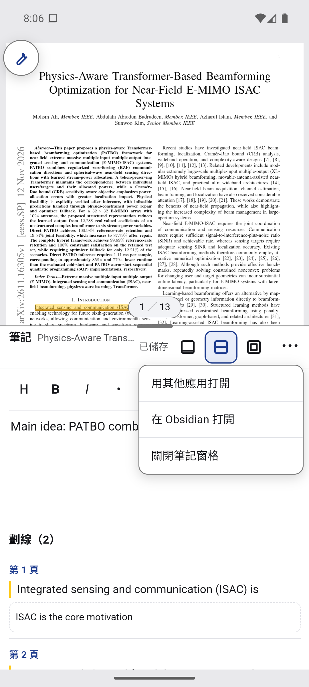
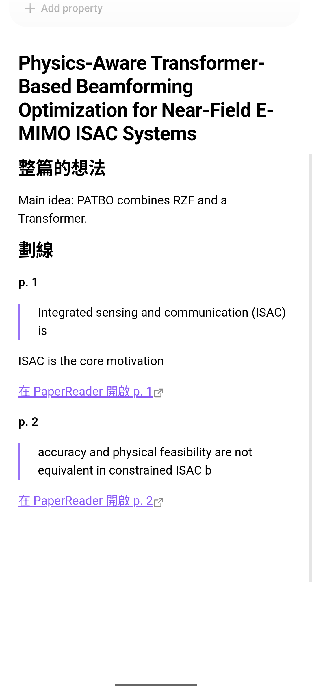

# 筆記與 Obsidian

你在 PaperReader 裡寫的劃線、短評與整篇的想法，每一篇存成一份 Markdown 檔。這份說明檔案在哪裡、長什麼樣子，以及怎麼讓 Obsidian 讀寫同一份。

## 筆記檔在哪裡

| 項目 | 內容 |
|---|---|
| 資料夾 | 文獻庫裡的 `notes`。文獻庫在共用空間時，就是手機的「文件／PaperReader／notes」 |
| 一篇幾份 | 一份。第一次劃線、寫想法，或按「用其他應用打開」時建立 |
| 檔名 | 通常是那篇的資料夾名稱加 `.md`，例如 `Chen 2025 - An Example Paper.md` |
| 怎麼對到那一篇 | 看檔案開頭的 `paperreader_paper`，不看檔名。在筆記工具裡改檔名沒關係 |

「設定 → 筆記」也寫著「筆記檔在文獻庫的 notes 資料夾」。這一版不能把筆記資料夾改到別處。

重點筆記（AI 產生的）不在 `notes`，在每一篇自己的資料夾裡，叫 `digest.md`（見[翻譯與重點筆記](翻譯與重點筆記.md)）。

## 檔案長什麼樣子

一份有一段想法、一條劃線的筆記檔：

```markdown
---
paperreader_paper: 01JCK3W2E4H6J8K0M2N4P6Q8RS
paperreader_modified: 2026-11-15T14:03:27.004Z
paperreader_modified_by: 01JCK3T1A2B3C4D5E6F7G8H9JK
---

# An Example Paper

## 整篇的想法

<!-- paperreader:thoughts -->
方法簡單，但實驗只在一個資料集上做。
<!-- paperreader:thoughts-end -->

## 劃線

<!-- paperreader:highlights -->
<!-- paperreader:highlight {"v":1,"id":"h-01jck5a7m3q9x2v8b4n6r0t1yz", …} -->
**p. 7**

> This sentence was highlighted in the paper.

^h-01jck5a7m3q9x2v8b4n6r0t1yz

這一句之後要回來查。

[在 PaperReader 開啟 p. 7](paperreader://open?paper=…&page=7&highlight=h-01jck5a7m3q9x2v8b4n6r0t1yz)
<!-- paperreader:highlight-end -->

<!-- paperreader:highlights-end -->
```

| 部分 | 是什麼 | 在筆記工具裡可以改嗎 |
|---|---|---|
| 開頭 `---` 之間的屬性 | `paperreader_` 開頭的三行是應用用的 | 這三行不要改；可以加你自己的屬性（例如 `tags`），應用會原樣留著 |
| `# 篇名`、`## 整篇的想法`、`## 劃線` | 給人看的標題 | 可以改，應用不看標題 |
| `<!-- paperreader:… -->` 這種行 | 應用用來認出各段的標記 | 不要改、不要刪 |
| 兩個 `thoughts` 標記之間的文字 | 整篇的想法 | 可以改 |
| `**p. 7**` 與 `>` 開頭的引句 | 劃線的頁碼與原文 | 改了不會改到劃線本身 |
| `^h-…` 那一行 | 這條劃線的區塊代號 | 不要改 |
| 區塊代號下面的文字 | 短評 | 可以改，應用讀到的就是改過的 |
| 「在 PaperReader 開啟 p. 7」 | 點了回到 PaperReader 的那一頁 | 不要改 |
| 標記以外你自己加的段落 | 你的內容 | 可以，應用不讀、不改 |

一條劃線的結尾標記不見了，應用會說「這一條的結尾標記不見了，只能看、不能改。」把那一行補回去就恢復。

在別的筆記裡可以用 `![[檔名#^h-…]]` 嵌入一條劃線的引句。

## 讓 Obsidian 讀到同一份

### 前提

文獻庫要放在共用空間。第一次加入文獻時要按「開啟權限」（見[安裝與第一次使用](安裝與第一次使用.md)）。放在應用專屬空間時，Obsidian 讀不到。

### 設定一次

1. 在 Obsidian 選擇把手機上一個既有的資料夾當成保存庫（vault）。
2. 選「文件／PaperReader」這個資料夾，也就是文獻庫本身，不是裡面的 `notes`。Obsidian 要求檔案權限時允許。
3. 保存庫的名稱會是資料夾的名稱 `PaperReader`，不要改。

Obsidian 的畫面與按鈕名稱照它當時的版本。設好之後，Obsidian 的檔案列會看到 `notes`、`papers` 等資料夾。

保存庫要設在文獻庫的最上層、名稱是 `PaperReader`，PaperReader 的「在 Obsidian 打開」才找得到那份筆記。

### 從 PaperReader 跳到 Obsidian

在閱讀畫面打開筆記窗格，按右上角的選單，選「在 Obsidian 打開」，Obsidian 就會開到這一篇的筆記。



「用其他應用打開」的清單裡沒有 Obsidian，請用「在 Obsidian 打開」。

### 在 Obsidian 裡看



- **閱讀模式**：看到篇名、整篇的想法、每條劃線的頁碼、引句、短評與「在 PaperReader 開啟 p. N」。點那個連結回到 PaperReader 的那一頁。
- **編輯模式**：每條劃線前面會多出一段標記資料。這是正常的，切回閱讀模式就看不到。

### 兩邊都改的時候

- 在 Obsidian 改完回到 PaperReader，筆記窗格與重點筆記會讀到新的內容。
- PaperReader 正在寫的時候，檔案剛好在 Obsidian 被改過：PaperReader 不會蓋掉 Obsidian 的修改，會說「筆記檔在別處改過，已重新讀取；剛才的修改沒有存進去。」，並把你剛才那段字留在「剛才這段沒存進去：」底下，可以「複製」「加到最後」或「不要了」。
- 要刪一條劃線，請在 PaperReader 裡刪。在 Obsidian 刪掉的劃線，用同步包和另一台合併之後會回來（見[備份與同步包](備份與同步包.md)）。

### Obsidian 自己的檔

Obsidian 會在文獻庫裡建一個 `.obsidian` 資料夾放它的設定。PaperReader 不讀、不改它，備份檔與同步包也不帶它。

## 不用 Obsidian 時

- 筆記窗格選單的「用其他應用打開」把筆記檔交給手機上其他打得開 Markdown 的應用。
- 筆記檔是一般的 Markdown 文字檔，用檔案管理員複製到電腦，任何文字編輯器都打得開。
- 「匯出與列印」的「匯出筆記」把這一篇的筆記檔另存一份到你選的位置。

---

截圖中的論文：*Physics-Aware Transformer-Based Beamforming Optimization for Near-Field E-MIMO ISAC Systems*（[arXiv:2611.16305](https://arxiv.org/abs/2611.16305)，作者見該頁），以 [CC BY 4.0](https://creativecommons.org/licenses/by/4.0/) 授權。截圖只縮放顯示。範例檔裡的篇名、引句與代號都是為了說明格式編的。
