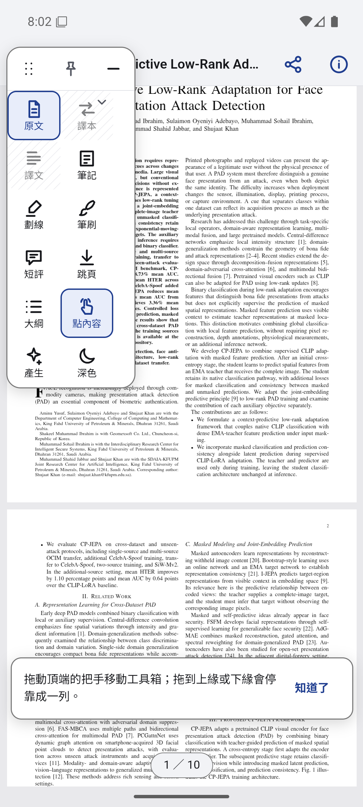
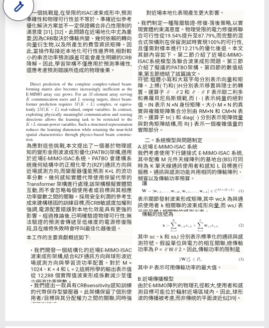
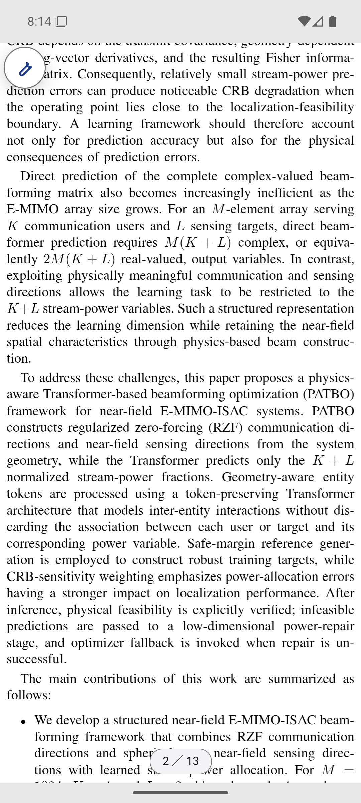

# 閱讀與劃記

在首頁點一篇文獻，就進入閱讀畫面。這份說明每一項操作怎麼做。讀到哪裡會自動記下，不必另外存。

## 閱讀畫面上有什麼

| 部分 | 在哪裡 | 做什麼 |
|---|---|---|
| 頁面 | 整個畫面 | 上下捲動翻頁；兩指縮放 |
| 頁碼 | 下方中間，例如「3 ／ 13」 | 點一下跳頁 |
| 頂列 | 點一下頁面就出現或收起 | 返回、篇名、原文與譯本互換、「匯出與列印」、「文獻資訊」 |
| 工具箱 | 預設是角落的一顆圓鈕 | 所有閱讀工具，見下一節 |

## 工具箱

點角落的圓鈕展開工具箱，再點一次縮小。

| 工具 | 做什麼 |
|---|---|
| 原文 | 回到原文 PDF |
| 譯本 | 看上次選的那份譯本；長按或按旁邊的小箭頭，選要看哪一份 |
| 譯文 | 看排成手機好讀的譯文（見[翻譯與重點筆記](翻譯與重點筆記.md)） |
| 筆記 | 打開或關閉筆記窗格 |
| 劃線 | 劃線模式：開著時選字就直接劃線 |
| 筆刷 | 在頁面上用手指畫 |
| 短評 | 劃線並寫一兩句話 |
| 跳頁 | 跳到指定的頁 |
| 大綱 | PDF 自帶的目錄 |
| 點內容 | 開關：點頁面上的段落、劃線、疊譯文、引用編號時要不要有反應 |
| 產生 | 翻譯這篇，或產生重點筆記 |
| 深色 | 頁面跟著深色外觀反相 |

工具箱可以放成三種樣子：

- **縮小**：一顆圓鈕。新安裝時是這個樣子。
- **浮動**：按住頂端的把手拖動，可以放在畫面任何地方。浮動時選了原文、譯本、譯文或筆記，工具箱會自己縮回圓鈕，不擋住頁面。
- **停靠**：拖到畫面上緣或下緣，會停靠成一列；拖離邊緣就回到浮動。停靠在下緣時，頁碼併進這一列。

按工具箱上的圖釘，或在「設定 → 閱讀」打開「釘住工具箱」，浮動時選了檢視也不收起。

## 原文與譯本切換

一篇有譯本時（自己加入的譯本 PDF，或在應用裡產生的），可以在原文與譯本之間切換，停在同一頁的同一處。

- **最快的方法**：點頁面叫出頂列，按篇名右邊的互換鈕，在「切到譯本」與「切到原文」之間來回。
- **工具箱**：按「原文」或「譯本」。
- **選要看哪一份**：長按工具箱的「譯本」，或按它旁邊的小箭頭，出現「要看哪一份」：原文、每一份譯本（標出是產生的還是自己加入的，以及做好的時間）、原頁疊譯文、譯文。選了哪一份，下次按「譯本」就直接到它。

譯本 PDF 的頁數比原文少時，切過去會停在最後一頁，畫面會說一聲。

### 原頁疊譯文

「原頁疊譯文」把譯文直接畫在原文頁面上、蓋住原本的段落，版面、圖、公式都還是原文的。點一下某段譯文，可以暫時看那一段的原文。

原頁疊譯文上不能劃線。要在譯文上劃線，請切到產生的譯本 PDF。

## 放大與捲動

| 動作 | 結果 |
|---|---|
| 兩指張開或捏合 | 自由縮放 |
| 在雙欄論文的某一欄上點兩下 | 放大到那一欄的寬度；往下捲會接到下一頁的同一欄 |
| 再點兩下 | 縮回整頁 |
| 單欄的頁面、或第 1 頁跨兩欄的摘要上點兩下 | 放大到文字區的寬度 |

放大讀某一欄時離開，下次打開會停在同一欄。

## 跳頁與大綱

- **跳頁**：點下方的頁碼，或按工具箱的「跳頁」，輸入頁數再按「跳過去」。
- **大綱**：按工具箱的「大綱」，列出 PDF 自帶的目錄，點一項就跳過去。沒有附目錄的 PDF 會說「這份 PDF 沒有大綱。」

## 劃線

1. 在原文或譯本 PDF 上長按一個字，拖動選取範圍。
2. 放開之後，選取的地方旁邊出現兩個按鈕：「劃線」與「劃線並寫短評」。按其中一個。

常常要劃線時，按工具箱的「劃線」打開劃線模式（「劃線模式：選字即劃線」），之後選字放開就直接劃線，不必再按。再按一次關掉。

選不到字的頁面（例如掃描的 PDF）會說「這一頁選不到文字（可能是掃描檔）。」

## 短評

短評是附在一條劃線上的一兩句話。

- **劃線時一起寫**：選字後按「劃線並寫短評」，或按工具箱的「短評」。
- **之後補上或修改**：點一下那條劃線（「點內容」要開著），打開「劃線與短評」。也可以在筆記窗格的劃線清單裡直接改。
- **刪掉一條劃線**：在「劃線與短評」按「刪除這條劃線」，再按一次確定。刪掉的劃線無法復原。

沒有選字就按「短評」時，會用畫面上第一行字劃線並打開短評。

劃線與短評都存在這篇的筆記檔裡，Obsidian 等筆記工具打得開（見[筆記與 Obsidian](筆記與Obsidian.md)）。

## 筆刷

按工具箱的「筆刷」，畫面下方出現筆刷列，選好顏色與粗細就能直接在頁面上畫。每畫完一筆就存好。

| 筆刷列上的 | 做什麼 |
|---|---|
| 紅色筆刷、藍色筆刷、黃色螢光筆 | 換顏色；螢光筆是半透明的 |
| 細線、粗線 | 換粗細 |
| 橡皮擦 | 點一筆，就刪掉那一筆 |
| 復原上一筆 | 拿掉剛畫的那一筆 |
| 上一頁、下一頁 | 筆刷開著時，手指在頁面上是畫線，用這兩個鈕換頁 |
| 清除這一頁的筆跡 | 刪掉這一頁全部的筆跡；會先問一次，刪了無法復原 |

再按一次工具箱的「筆刷」就收起筆刷列。筆跡跟著畫在哪一份 PDF 上：畫在原文上的只出現在原文，畫在譯本上的只出現在譯本。

## 筆記窗格

按工具箱的「筆記」，打開可以和文獻並排的筆記窗格：直式握持時在下方，橫式時在右側。

- **整篇的想法**：一個 Markdown 編輯器，有標題、粗體、斜體、清單、引用、連結的按鈕，可以在「編輯」與「預覽」之間切換。停筆一秒就自動儲存。
- **劃線清單**：列出這篇的每一條劃線（頁碼、引句、短評）。點一條跳到那一頁。
- **大小**：「縮成一條」「半開」「全開」三種；半開時拖動邊界可以調整大小。
- **選單**：「用其他應用打開」「在 Obsidian 打開」「關閉筆記窗格」。

## 點內容

「點內容」開著時（預設），點頁面上的東西會有反應：

| 點的地方 | 結果 |
|---|---|
| 一條劃線 | 打開它的短評 |
| 原文正文裡的引用編號，例如「[12]」 | 出引用卡片（見下一節） |
| 原頁疊譯文的一段 | 暫時看那一段的原文 |
| 在應用裡翻譯過的文獻，原文或譯本 PDF 上的一段 | 出一個小框，看另一種語言的那一段，按「改」可以就地改譯文 |
| 其他地方 | 叫出或收起頂列 |

覺得容易誤觸時，按工具箱的「點內容」關掉，之後點頁面只會叫出或收起頂列。

## 文獻之間的連結

應用開著的時候，「整理文獻庫」會在閒著時讀每篇原文，抽出參考文獻，並在文獻庫裡找每一條引的是哪一篇。比對全部在手機上做，不連網。剛加入的文獻要等它處理過，「設定 → 文獻庫」看得到已處理幾篇。

### 引用卡片

在原文上點正文裡的引用編號，例如「[12]」或「[3, 5–7]」，會出一張卡片：

- 卡片上列出那幾條參考文獻的原文。
- 文獻庫裡有那一篇時，按「開啟」直接打開它；按返回鍵回到原來那一頁。
- 只靠篇名比對、還不確定的，寫「可能是：」加上篇名。
- 作者與年份式的引用，例如「(Zhao, 2024)」，列出可能的幾條，標「可能是這一條」。

卡片只在原文上出現，譯本 PDF 與原頁疊譯文上沒有；「點內容」要開著。

### 文獻資訊裡的參考文獻

在閱讀畫面按頂列的「文獻資訊」。抽過參考文獻的文獻，這一頁會多兩節：

| 一節 | 內容 |
|---|---|
| 參考文獻（N 條，庫裡有 K 篇） | 每一條一列：編號與原文，點原文看全文。連上的寫那一篇的篇名，點篇名打開它。還在處理時標「整理中」 |
| 庫裡引用這篇的（M 篇） | 文獻庫裡哪幾篇引了這一篇，各用的是它們的第幾條。點一列打開那篇。沒有就不顯示 |

### 連錯了或沒連上

列上寫「可能是」時，確定是那一篇就按旁邊的「是這篇」。其餘的在每一條列尾的「⋯」：

| 選項 | 什麼時候用 | 結果 |
|---|---|---|
| 不是這篇 | 連上了，但連錯了 | 這一條不再連到那一篇。重新抽取之後也一樣 |
| 指定、指定別篇 | 沒連上，或想改連到別篇 | 從文獻庫挑一篇（可以搜尋篇名、作者、年份）連上 |
| 看原文 | 想看這一條在原文的哪裡 | 跳到原文裡這一條的位置 |
| 撤銷否決 | 之前按錯了「不是這篇」 | 取消那一次否決 |

這些判斷存在那一篇的資料夾裡，跟著備份檔與同步包走。原文換過、重新抽取之後對不上原來那一條的判斷，收在「找不回的判斷」底下，可以「清除」或「全部清除」。判斷到了上限時，畫面會請你先清除找不回的判斷。

## 深色

- 「設定 → 外觀 → 深淺色」決定整個應用是淺色、深色，或跟隨系統。
- 工具箱的「深色」（等同「設定 → 閱讀 → 閱讀時頁面跟著深色」）讓 PDF 頁面也反相成深底淺字。只在深色外觀時作用；圖片的顏色也會跟著改變。

## 讀到哪裡

- 停下來約兩秒，就記下這一頁、頁內的位置、放大的那一欄。
- 下次打開同一篇，停在同一處。首頁的「繼續閱讀」一次點擊就回到上次那一頁。
- 「設定 → 閱讀 → 打開應用時先到」可以選「上次讀的那一篇」，一打開應用就直接在閱讀畫面。
- 「設定 → 閱讀 → 閱讀時螢幕不自動關閉」打開時，閱讀時螢幕不會自動關。

## 其他

- **匯出與列印**：頂列的分享鈕可以分享原文、匯出帶劃線與筆跡的 PDF、匯出筆記、匯出譯文，或列印原文。匯出的檔放在你選的位置，原文不變。
- **首次提示**：不明顯的手勢第一次用到時會出現一次說明。想再看一次，到「設定 → 關於 → 說明」按「重新顯示首次提示」。

---

截圖中的論文：*Context-Predictive Low-Rank Adaptation for Face Presentation Attack Detection*（[arXiv:2611.16534](https://arxiv.org/abs/2611.16534)）與 *Physics-Aware Transformer-Based Beamforming Optimization for Near-Field E-MIMO ISAC Systems*（[arXiv:2611.16305](https://arxiv.org/abs/2611.16305)），作者見各自的 arXiv 頁面，都以 [CC BY 4.0](https://creativecommons.org/licenses/by/4.0/) 授權。原頁疊譯文那一張（2611.16305 第 2 頁）的中文是應用以離線翻譯產生的機器翻譯，截圖只裁了頁面的一部分；其餘截圖只縮放顯示。
